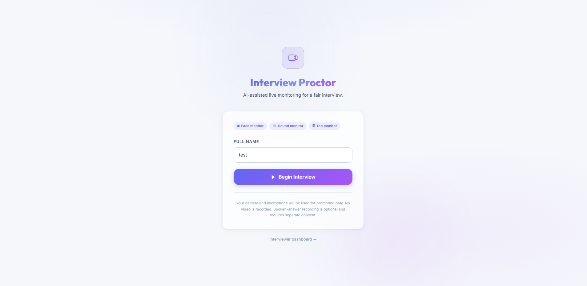
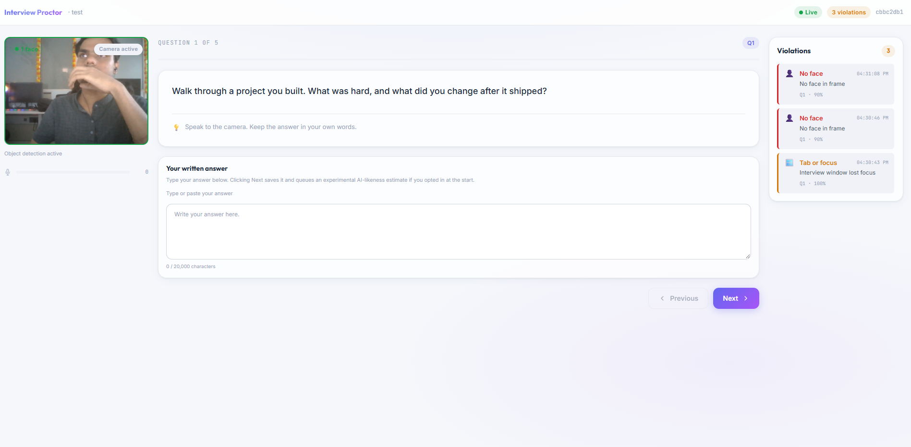
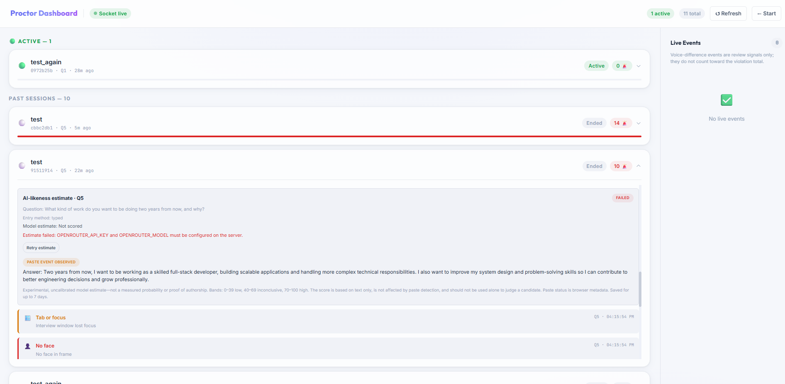

# AI-Powered Online Assessment & Cheating Detection System

An AI-powered online assessment monitoring system designed to identify suspicious candidate activities during online interviews or assessments. The platform combines browser-based monitoring, audio analysis, and AI-based response analysis to help administrators monitor candidates in real time.

## Project Overview

The system consists of two main portals:

- **Candidate Portal:** Replicates the actual assessment portal and monitors candidate activities during assessments.
- **Admin Portal:** Provides administrators with real-time monitoring, violation tracking, candidate information, and AI-based response analysis.

The application uses Next.js for the frontend, Node.js for backend services, and Socket.IO for real-time communication between the candidate and admin portals.



## Key Features

### 1. Third-Party Proctoring
- AutoProctor monitors face count, sound, tab switching, and multiple screens after explicit candidate consent. In the current configuration, forced fullscreen and random photos are disabled; the website blocks and logs right-click and copy/paste attempts.
- The server signs each interview attempt with HMAC-SHA256; the client secret never leaves the backend.
- AutoProctor SDK events are shown as review signals and do not automatically increase violation counts.
- Full-session recording and optional paid add-ons are not enabled.

### 2. AI-Based Response Analysis
- Integrates OpenRouter for AI-based candidate response analysis.
- Estimates whether candidate responses may be AI-generated or agent-assisted.
- Flags responses when the estimated AI/agent-generated score is **60% or higher**.
- Helps administrators identify potentially suspicious responses, including cases where candidates may be reading AI-generated answers.



## Admin Dashboard

The admin portal provides a centralized interface for monitoring candidates and reviewing suspicious activities.

### Dashboard Capabilities

- Live monitoring of multiple candidates.
- Real-time violation updates using Socket.IO.
- Candidate information and assessment details.
- Violation history for individual candidates.
- Candidate response monitoring.
- AI-based response analysis with percentage scores.
- Identification of responses flagged by the AI detection system.
- Centralized view of candidate violations and response information.

 

## Technology Stack

| Technology | Purpose |
|---|---|
| Next.js | Frontend development |
| Node.js | Backend development |
| Socket.IO | Real-time communication |
| ONNX Runtime | Speech activity detection for spoken answers |
| OpenRouter | AI-based response analysis |

## System Architecture

```text
              Candidate Portal
                     |
          AutoProctor SDK Monitoring
                     |
        -----------------------------------
        |              |                  |
       Face         Sound           Tab switching
      checks        checks             checks
        -----------------------------------
                     |
                Node.js Backend
                     |
                 Socket.IO
                     |
              Admin Dashboard
                     |
        --------------------------------
        |              |               |
    Live Alerts    Candidate Data   AI Analysis
        |              |               |
        --------------------------------
```

## Current Implementation Status

| Feature | Technology | Status |
|---|---|---|
| Candidate Portal | Next.js | Implemented |
| Admin Portal | Next.js | Implemented |
| Real-time Monitoring | Socket.IO | Implemented |
| Face/audio/tab monitoring | AutoProctor SDK | Implemented |
| AutoProctor event timeline | Server + admin dashboard | Implemented (review only) |
| AI Response Analysis | OpenRouter | Implemented |
| AI-generated Response Flagging | 60% threshold | Implemented |

## Important Note

AI-generated response scores are estimates intended to assist administrators in identifying potentially suspicious behavior. They should not be treated as definitive proof of cheating. Final assessment decisions should involve human review and additional context.

AutoProctor processes candidate camera and microphone input and may collect evidence such as tab-switch screenshots. Candidates are shown a separate consent notice before the SDK starts. Review its privacy terms and data-retention controls before using real candidate data. AutoProctor events shown in this application are client-reported review signals, not proof of misconduct.

## Project Goal

The primary goal is to improve the integrity and reliability of online assessments by combining multiple monitoring techniques into one platform, providing administrators with real-time visibility into candidate activities and potential assessment violations.

FrontendURL: https://interview-cheating-detector.vercel.app/
Backend URL: https://interview-cheating-detector-1eyj.vercel.app/
