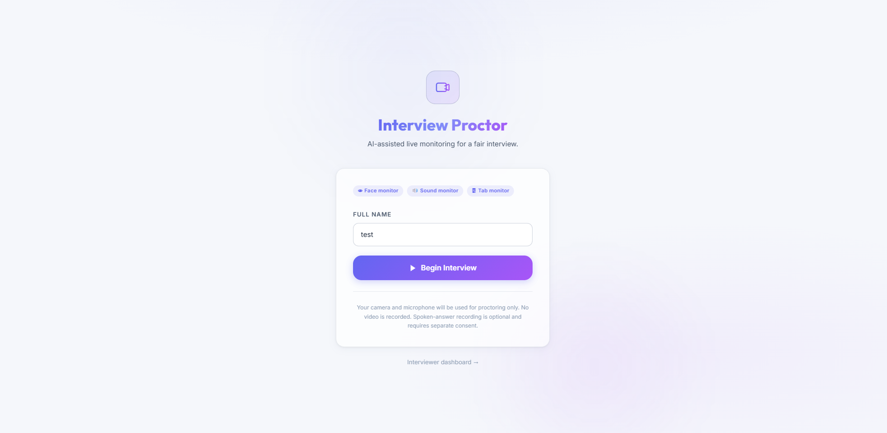
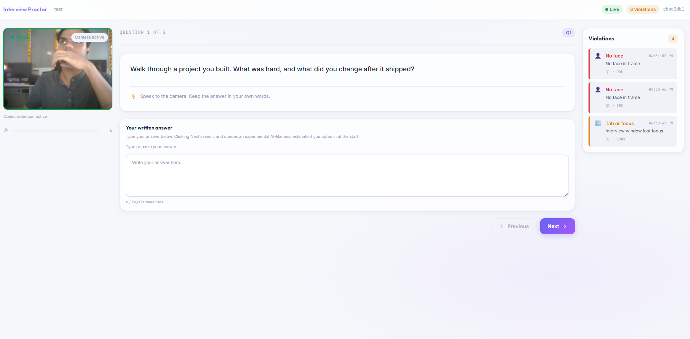
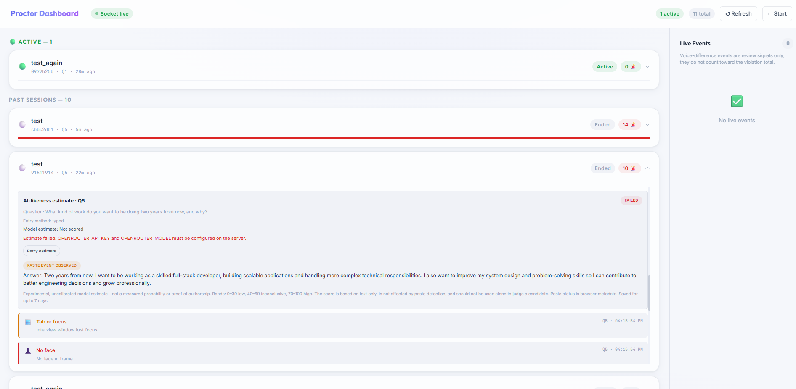

# AI-Powered Online Assessment & Cheating Detection System

An AI-powered online assessment monitoring system designed to identify suspicious candidate activities during online interviews or assessments. The platform combines browser-based monitoring, computer vision, object detection, audio analysis, and AI-based response analysis to help administrators monitor candidates in real time.

## Project Overview

The system consists of two main portals:

- **Candidate Portal:** Replicates the actual assessment portal and monitors candidate activities during assessments.
- **Admin Portal:** Provides administrators with real-time monitoring, violation tracking, candidate information, and AI-based response analysis.

The application uses Next.js for the frontend, Node.js for backend services, and Socket.IO for real-time communication between the candidate and admin portals.



## Key Features

### 1. Tab Switching & Window Minimize Detection
- Detects when candidates switch browser tabs.
- Identifies when the assessment window loses focus or is minimized.
- Uses built-in browser APIs to monitor candidate activity.

### 2. Multiple Face Detection
- Uses Amazon Rekognition to count faces in consented camera snapshots.
- MediaPipe is retained only for gaze and head-orientation monitoring.

### 3. Looking Away Detection
- Uses MediaPipe face landmarks to monitor candidate facial orientation.
- Detects when candidates repeatedly look away from the camera.

### 4. Multiple Person Detection
- Identifies the presence of additional people during an assessment.
- Uses person detections returned by Amazon Rekognition.

### 5. Electronic Device Detection
- Uses Amazon Rekognition label detection.
- Detects electronic devices such as:
  - Mobile phones
  - Laptops
  - Other supported electronic devices

### 6. Audio & Sound Detection
- Uses the Web Audio API and WavLM library.
- Monitors audio input for potentially suspicious sounds.
- Includes sound detection testing and refinement.

### 7. AI-Based Response Analysis
- Integrates OpenRouter for AI-based candidate response analysis.
- Estimates whether candidate responses may be AI-generated or agent-assisted.
- Flags responses when the estimated AI/agent-generated score is **60% or higher**.
- Helps administrators identify potentially suspicious responses, including cases where candidates may be reading AI-generated answers.

### 8. Required Amazon Rekognition Face and Object Detection
- Candidates must consent to sending a reduced-size camera snapshot to Amazon Rekognition every five seconds. The application does not store the snapshots.
- The server checks AWS access before camera startup. Missing consent, AWS configuration, or required permissions prevents the interview from starting; a later Rekognition failure stops the interview. There is no local face-count or YOLO fallback.
- Each snapshot is checked with `DetectFaces` and `DetectLabels`; the readiness check also makes both calls. AWS charges may apply.
- Object checks use Rekognition labels for people, phones, laptops, books, keyboards, mice, TVs, and remotes.
- Configure `AWS_REGION` and the AWS SDK default credential chain on the **Server** deployment, allowing only `rekognition:DetectFaces` and `rekognition:DetectLabels`. Prefer a runtime IAM role/OIDC where supported; otherwise use server-only deployment secrets. Never put AWS credentials in frontend environment variables or commit them to the repository.
- Face counts are imperfect signals; admins should review context rather than treating a detection as proof of misconduct.



## Admin Dashboard

The admin portal provides a centralized interface for monitoring candidates and reviewing suspicious activities.

### Dashboard Capabilities

- Live monitoring of multiple candidates.
- Real-time violation updates using Socket.IO.
- Candidate information and assessment details.
- Violation history for individual candidates.
- Candidate response monitoring.
- AI-based response analysis with percentage scores.
- Identification of responses flagged by the AI detection system.
- Centralized view of candidate violations and response information.

 

## Technology Stack

| Technology | Purpose |
|---|---|
| Next.js | Frontend development |
| Node.js | Backend development |
| Socket.IO | Real-time communication |
| MediaPipe | Gaze and head-orientation monitoring |
| ONNX Runtime Web | Voice activity detection dependency |
| Web Audio API | Audio monitoring |
| WavLM | Audio analysis |
| OpenRouter | AI-based response analysis |
| Amazon Rekognition | Required server-side face and object detection |

## System Architecture

```text
              Candidate Portal
                     |
          Browser & Camera Monitoring
                     |
        --------------------------------
        |       |       |       |      |
       Tab    Face    Object  Audio   Response
     Detection Detection Detection Analysis Analysis
        |       |       |       |      |
        --------------------------------
                     |
                Node.js Backend
                     |
                 Socket.IO
                     |
              Admin Dashboard
                     |
        --------------------------------
        |              |               |
    Live Alerts    Candidate Data   AI Analysis
        |              |               |
        --------------------------------
```

## Current Implementation Status

| Feature | Technology | Status |
|---|---|---|
| Candidate Portal | Next.js | Implemented |
| Admin Portal | Next.js | Implemented |
| Real-time Monitoring | Socket.IO | Implemented |
| Tab Switching Detection | Browser APIs | Implemented |
| Multiple Face Detection | Amazon Rekognition | Implemented; AWS and consent required |
| Looking Away Detection | MediaPipe | Implemented |
| Multiple Person Detection | Amazon Rekognition | Implemented |
| Electronic Device Detection | Amazon Rekognition | Implemented |
| Audio Detection | Web Audio API + WavLM | Implemented and refined |
| AI Response Analysis | OpenRouter | Implemented |
| Amazon Rekognition Face and Object Detection | AWS Rekognition | Required; blocks interview startup if unavailable |
| AI-generated Response Flagging | 60% threshold | Implemented |

## Important Note

AI-generated response scores are estimates intended to assist administrators in identifying potentially suspicious behavior. They should not be treated as definitive proof of cheating. Final assessment decisions should involve human review and additional context.

## Project Goal

The primary goal is to improve the integrity and reliability of online assessments by combining multiple monitoring techniques into one platform, providing administrators with real-time visibility into candidate activities and potential assessment violations.

FrontendURL: https://interview-cheating-detector.vercel.app/
Backend URL: https://interview-cheating-detector-1eyj.vercel.app/
